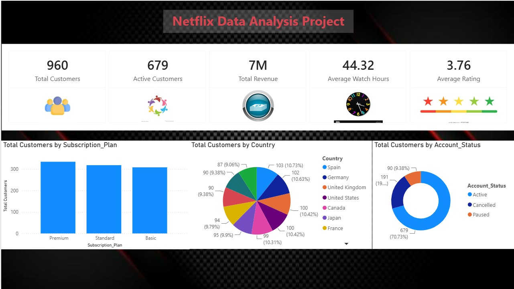
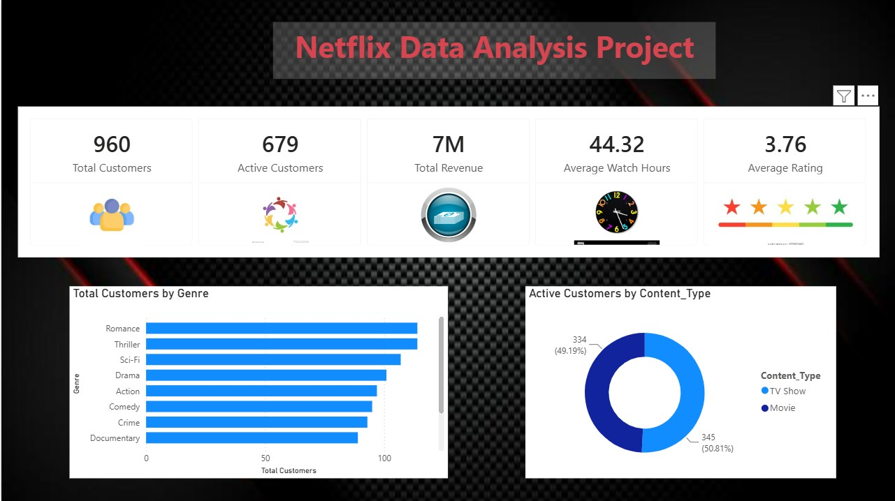
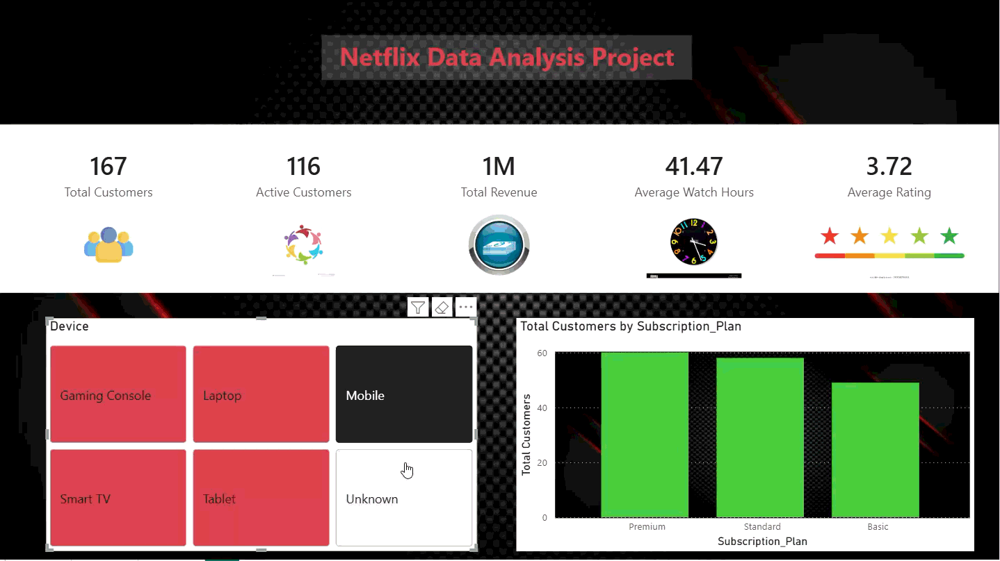

__Netflix Data Analysis Project__

I didn't start this project because I wanted to build a Netflix dashboard.

I started it because I wanted to learn Power BI, and I had no idea what I actually needed to learn.

There are hundreds of Power BI tutorials, playlists, crash courses and etc. So I decided to stop trying to figure out the perfect learning path. I'll just build something and learn whatever I need along the way.
I started with a deliberately messy Netflix-style customer dataset and took it through an entire analytics workflow:
Excel → Python/Pandas → MySQL → Power BI

It became my first proper attempt at understanding what happens before the dashboard — how messy data is cleaned, how business questions are converted into SQL queries, how metrics are defined, and how all of that eventually becomes something that a person can actually interact with.

____What I tried to build?_______________________________________________________________________________________________________________________

The raw file, Netflix_Unclean_Project.xlsx, contained 1,003 customer records with columns such as Age, Genre, Country, Subscription Plan, Device, Watch Hours, Monthly Fee, Ratings and dates.

It was intentionally messy.

There were:

Missing values, N/A, NULL, blanks and empty strings, Duplicate records
Extra spaces, Inconsistent capitalization, Invalid ages
Negative watch-hour values, Negative/invalid fee values
Dates that needed parsing
Numeric values stored in the wrong format

I used Jupyter Notebook with Pandas and NumPy as the main data-cleaning stage.

I first inspected the dataset using .info(), .describe(), shape checks and other basic checks to understand what I was actually working with.
Then I:

Removed duplicate records
Standardized N/A, NULL, blanks and similar placeholders
Stripped unnecessary whitespace
Standardized categorical text
Converted numeric columns using pd.to_numeric(errors="coerce")
Filtered invalid ages
Removed negative Watch Hours and Monthly Fee values
Converted Join_Date and Last_Watch_Date into datetime values
Handled remaining missing values using appropriate strategies
Validated the cleaned dataset before moving to the next stage

I also engineered additional fields:

Customer_Revenue
Monthly_Fee × Monthly_Sessions
This is a calculated metric created specifically for this project rather than actual Netflix revenue.

Engagement_Score
Watch_Hours + Monthly_Sessions + Download_Count
This is a simple custom engagement index used for exploratory analysis. It is not intended to represent a standardized industry metric.

Watch_Category
Customers were grouped into Low, Medium, High and Very High watch-hour categories.

Age_Group
Customers were grouped into:
18–25
26–35
36–50
51+

Active_Flag
A 1/0 flag representing whether an account is active.

After the current cleaning stage, the CSV still contains a small number of values that need further attention:

1 missing Country value
42 missing Watch Category values
5 negative Watch Hours values
3 negative Monthly Fee values

I'm keeping this documented for a future version, I would investigate these records and decide whether they should be corrected, removed or handled differently.

___Take the data into SQL________________________________________________________________________________________________________________________

Once the data was cleaned, I loaded it into MySQL.

I worked with MySQL Command Line + Workbench, and used SQL to turn business questions into queries.

Some of the questions I explored were:

How many customers are active, cancelled or paused?
Which subscription plan has the most customers?
Which plans generate the most revenue?
Which countries have the largest customer base?
Which devices are used most?
Which genres have the highest number of views?
What is the average rating by genre?
How does watch time differ between subscription plans?
Who are the top 10 customers by revenue?
What is the split between Movies and TV Shows?

___Turn the Analysis into Power BI Dashboard_____________________________________________________________________________________________________

Finally, I brought the cleaned data into Power BI.
by the time I reached it, I had a much better understanding of what I was actually visualizing.

I created DAX measures for metrics such as:

Total Customers
Active Customers
Cancelled Customers
Total Revenue
Average Watch Hours
Average Rating
Average Sessions

The dashboard includes slicers too

Dashboard

___The Data shows__________________________________________________________________________________________________________________________________

1,003 customer records in the dataset.
713 active customers, 198 cancelled customers and 92 paused customers.
Premium is the largest subscription group with 352 customers, followed by Standard with 329 and Basic with 322.
Spain, the United States, Canada and Germany are among the countries with the largest customer counts.
The most common devices in the dataset are Gaming Console, Smart TV, Tablet, Laptop and Mobile, with Gaming Console having the highest count.
The dataset contains 514 TV Shows and 489 Movies.
Average watch time is approximately 42.39 hours.
Average content rating is approximately 3.75/5.
Total calculated revenue from the Customer_Revenue field is ₹73,32,402.

___My biggest takeaways___________________________________________________________________________________________________________________________

My Biggest Takeaway

One of my biggest takeaways from this project was understanding that different tools may do similar things, but they are useful in different situations.

For example, I initially thought MySQL Command Line and MySQL Workbench were basically the same thing. While working with both, I understood that the Command Line is useful for directly interacting with the database through commands, while Workbench provides a more visual environment for managing databases, writing queries and working with database structures.

I also understood the difference between Power BI and Python libraries like Matplotlib and Seaborn. Matplotlib and Seaborn are great when I want to explore and visualize data while working inside Python. Power BI is more useful when I want to turn that analysis into an interactive dashboard that someone else can easily explore.

Similarly, I learned that Jupyter Notebook and code editors like PyCharm or VS Code serve different purposes. Jupyter is especially useful for experimenting with data, running code step by step and immediately seeing the results, while a code editor is better suited for building and managing larger, structured applications or projects.

I also learned that Excel and CSV are not alternatives where one is simply better than the other. Excel is useful for manual data work, formulas, formatting and inspecting data, while CSV is a simple and lightweight way to store and move tabular data between different tools.

The main lesson for me was that there isn't always a "better" tool. Each tool has its own purpose, strengths and limitations. What matters is understanding when and why to use each one, and how they can work together as part of the same workflow.

___Would explore next______________________________________________________________________________________________________________________________

If I continue working on it, I would like to investigate:

Why are customers cancelling or pausing their accounts?
Does customer engagement differ between active and cancelled customers?
Which subscription plans have the strongest engagement?
Which customer segments contribute the most calculated revenue?
Does customer behaviour change with account tenure?
Can customer lifetime value be estimated?
Can customer churn be predicted using machine learning?

___Tec Stack_______________________________________________________________________________________________________________________________________

Raw data      :	Microsoft Excel
Data cleaning & feature engineering	: Python, Pandas, NumPy, Jupyter Notebook
Database & querying	 : MySQL, MySQL Command Line, MySQL Workbench
Dashboard & reporting  : Power BI, DAX

___Running the project)___________________________________________________________________________________________________________________________

Clone this repository to your local machine.
Open Netflix_analysis.ipynb and run the notebook using the raw Excel dataset.
Use Netflix_Clean_Data.csv to create/load the netflix_customers table and run the SQL analysis queries.
Open Netflix_Analysis_Dashboard.pbix in Power BI Desktop and use the available slicers to explore the data.

(This project uses fictional, dummy data created purely for learning and portfolio purposes.)

__________________________________________________________________________________________________________________________________________________

I'm an MBA (Marketing & Finance) graduate who got into data analytics because I wanted stronger evidence behind the business decisions I had seen made in retail and sales roles.

This project was my way of learning analytics by actually building something end-to-end — from a messy spreadsheet to a cleaned dataset, SQL analysis and an interactive dashboard.

📧 ak997329@gmail.com
📍 Varanasi, India
